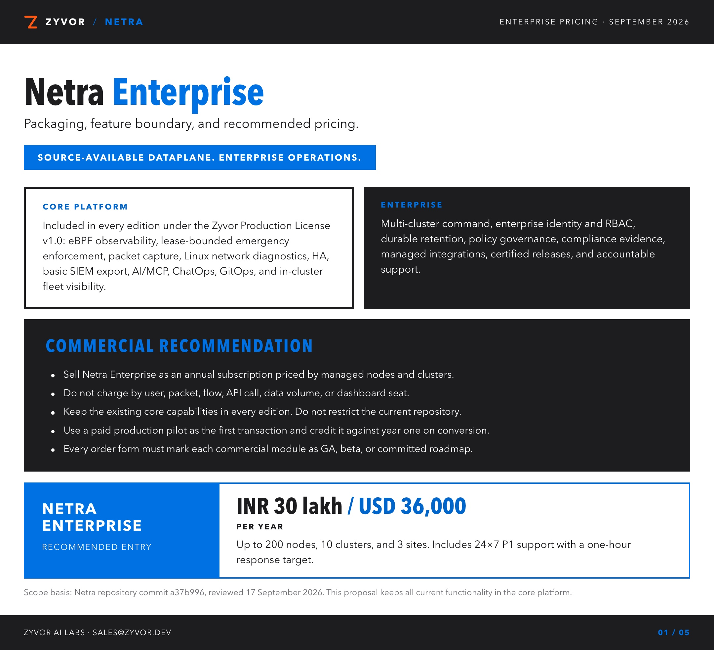
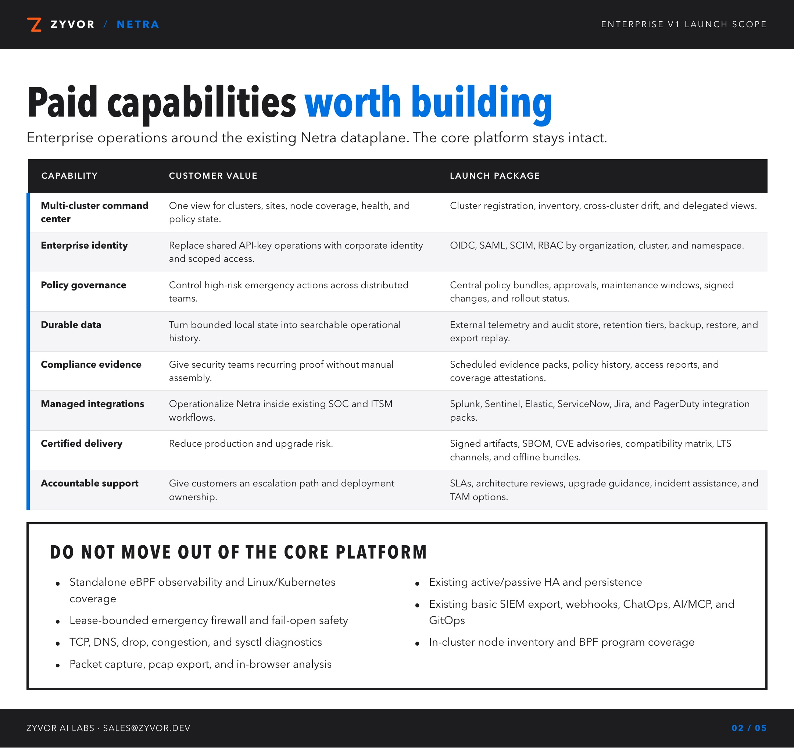
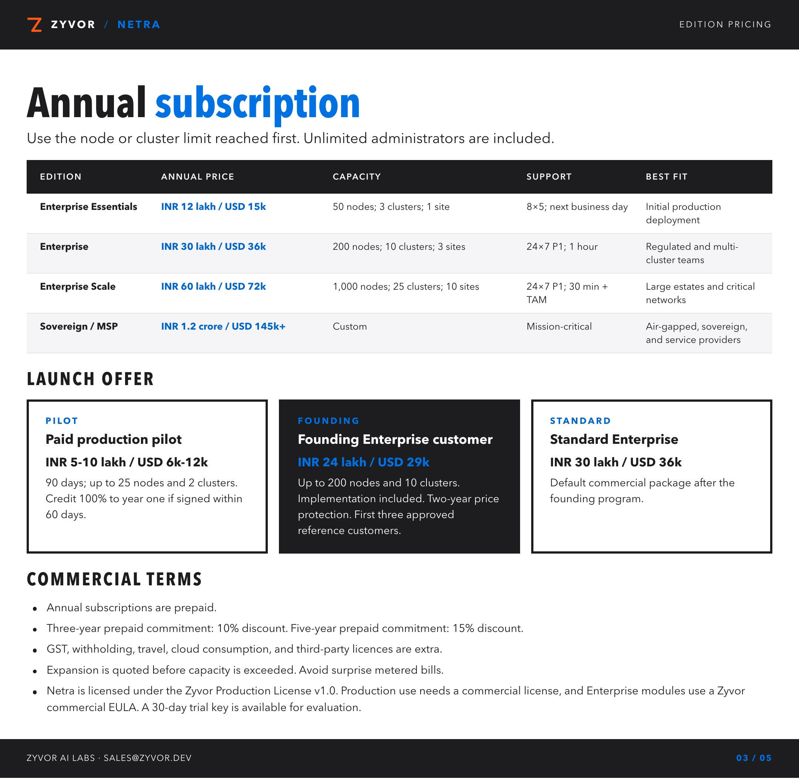
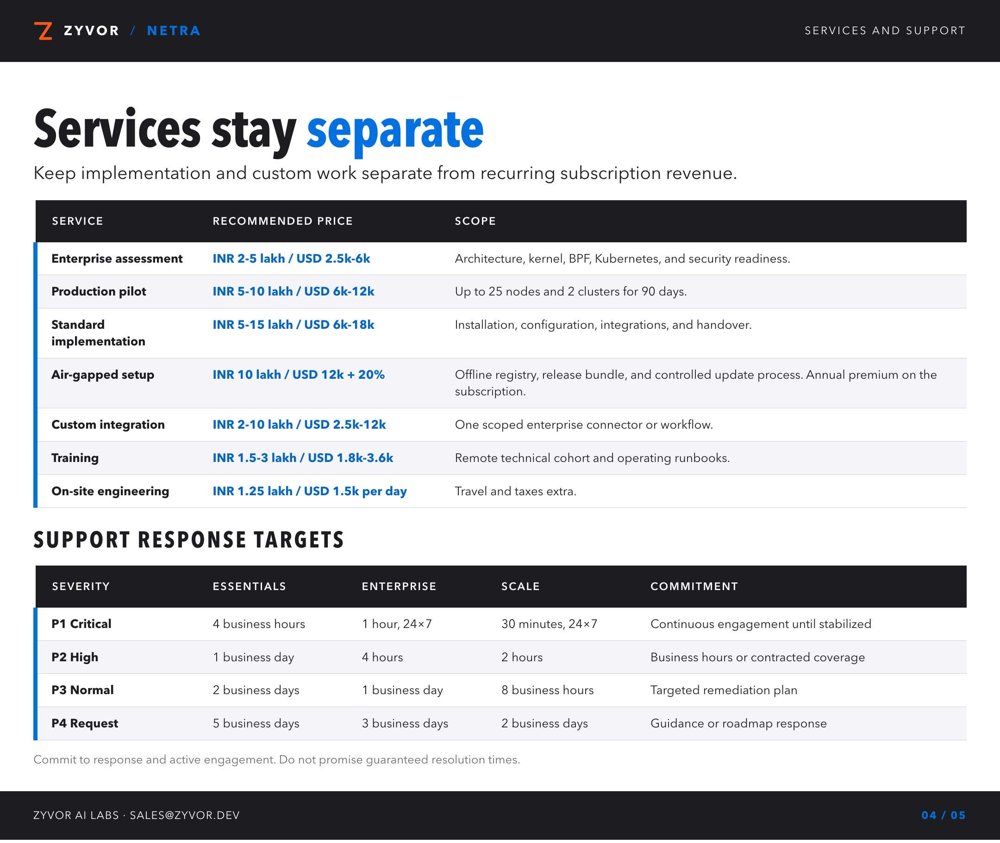
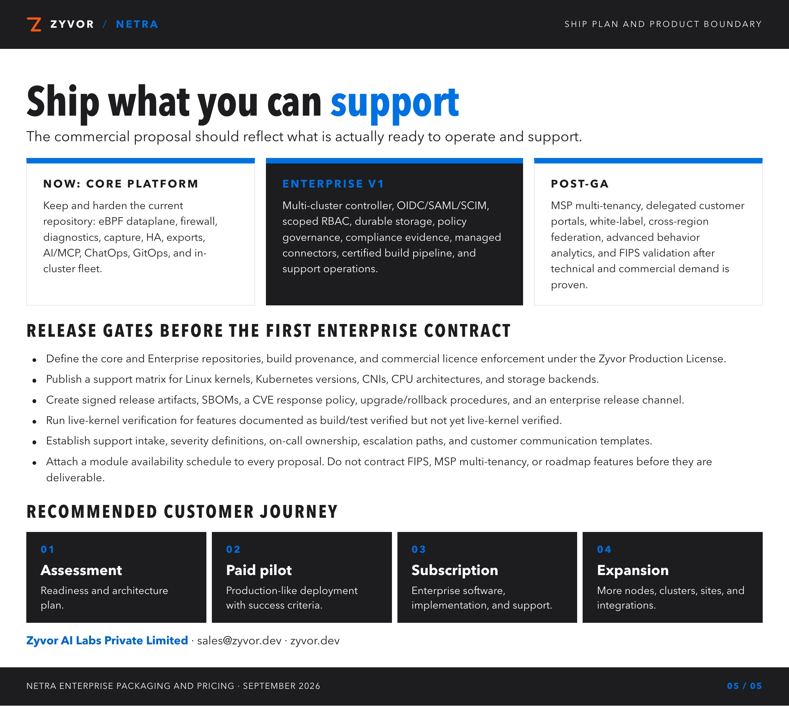

# Netra Enterprise pricing

Packaging, feature boundary, and recommended pricing. September 2026.
Orange, white, and black sheets for GitHub — source-available dataplane, enterprise operations.

Non-production use is free under the Zyvor Production License. Production use requires a commercial license. Enterprise subscriptions are by nodes and clusters, not by user, packet, flow, or seat.

[Download the PDF](./Zyvor-Netra-Enterprise-Pricing.pdf).

Worldwide price standard (supersedes any rounded INR figures in the sheets below): Essentials USD 15,000 / INR 1,486,800; Enterprise USD 36,000 / INR 3,568,320; Scale USD 72,000 / INR 7,136,640; founding USD 29,000 / INR 2,874,480; paid production pilot USD 6,000 to 12,000 / INR 594,720 to 1,189,440. USD excl. tax worldwide; INR incl. 18% GST in India. Buy or get a quote: [zyvor.dev/buy](https://zyvor.dev/buy); custom pricing: [sales@zyvor.dev](mailto:sales@zyvor.dev).

Scope basis: Netra repository commit `a37b996`, reviewed 17 September 2026.

Zyvor AI Labs Private Limited · [sales@zyvor.dev](mailto:sales@zyvor.dev) · [zyvor.dev](https://zyvor.dev)
